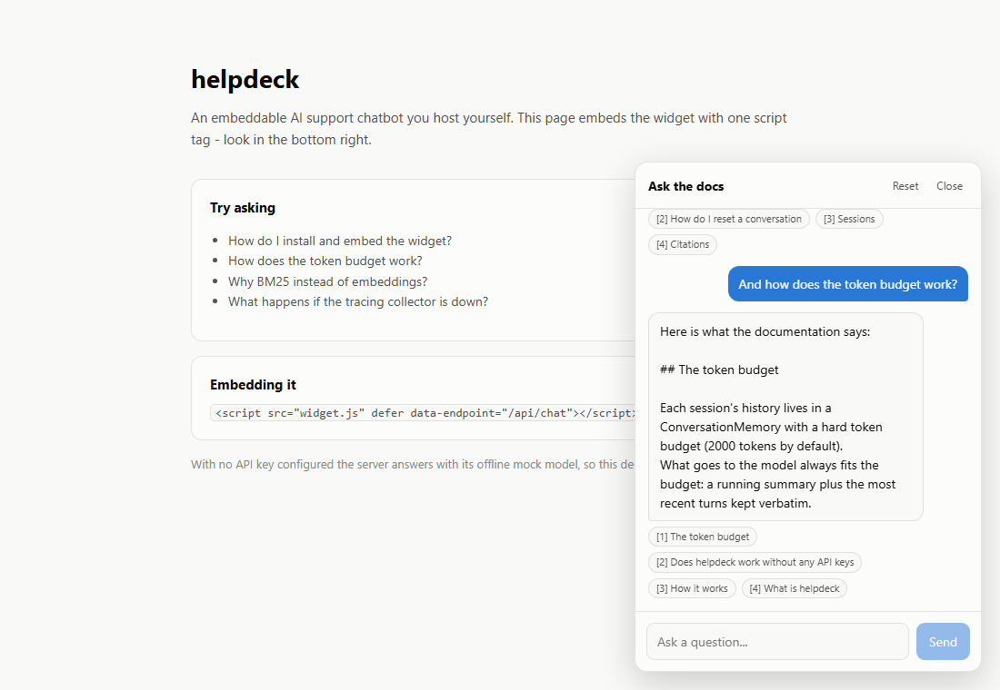
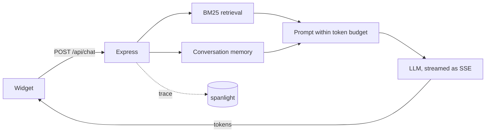

# helpdeck

[](https://github.com/Antheagao/helpdeck/actions/workflows/ci.yml)

An embeddable AI support chatbot you host yourself.
It answers questions about your product from your own markdown documentation, streams replies token by token, and cites the sections it used.



One script tag embeds it on any page:

```html
<script src="https://your-host/widget.js" defer data-endpoint="/api/chat"></script>
```

## Why it is built this way

Retrieval-augmented chat is usually assembled from a framework and two or three hosted services.
helpdeck implements the three interesting pieces itself, in the repository, with no framework dependency and no accounts beyond the single LLM key you bring:

- **Context-window memory** - a token-budgeted conversation buffer with rolling summarization, so a long chat never overflows the prompt (the job LangChain's summary-buffer memory does).
- **Retrieval** - BM25 with heading field-weighting over your markdown, so there is no embedding model, no vector database, and no retrieval API call.
- **Tracing** - traces, token counts, latency, and cost exported to [spanlight](https://github.com/Antheagao/spanlight), self-hosted (the job LangSmith or Langfuse does).

An offline mock model keeps the whole product - widget, retrieval, memory, tracing - runnable and testable with **zero API keys**.

## Quickstart

```bash
npm install
npm run widget:build
npm start                      # http://127.0.0.1:4319 - demo page + widget
```

With no key set it answers with the offline mock model.
To use a real model, put a key in `.env` (gitignored) and start with `node --env-file=.env`:

```bash
ANTHROPIC_API_KEY=sk-...       # or OPENAI_API_KEY
HELPDECK_MODEL=claude-haiku-4-5
```

| Variable | Default | Purpose |
|---|---|---|
| `PORT` | `4319` | Listen port |
| `MODEL_PROVIDER` | unset | `anthropic`, `openai`, or `mock`. Unset picks by key (Anthropic, then OpenAI, then the mock). An explicit value needs its key, and `mock` refuses to start beside a key or `HELPDECK_MODEL`, so a demo can never spend |
| `ANTHROPIC_API_KEY` / `OPENAI_API_KEY` | unset | Provider; unset means the offline mock |
| `HELPDECK_MODEL` | per provider | Override the model id |
| `HELPDECK_DOCS` | `./docs` | Knowledge-base directory |
| `SPANLIGHT_URL` | unset | Export traces to a spanlight collector |

## How a request flows



Retrieval, the LLM call, and memory compaction are each a span; when `SPANLIGHT_URL` is set, every request lands in the dashboard with its latency, token counts, and cost.
Tracing is fire-and-forget: if the collector is down, helpdeck logs one warning and keeps answering.

### Conversation memory

`render()` always fits the budget (2000 tokens by default).
The most recent six turns stay verbatim; older turns are folded into a running summary, written by the LLM when one is configured and by an extractive fallback otherwise - including when the summarizer call fails, so a provider hiccup degrades the summary instead of dropping the conversation.

### Retrieval

Each markdown heading section becomes one passage.
Heading terms are weighted above body terms, because a heading names its section's topic: without that, *"how does the token budget work?"* answered from the FAQ, since "does" and "work" happened to match there.
Question scaffolding (`how`, `does`, `can`, ...) is dropped from queries for the same reason. Both behaviors are pinned by regression tests.

## Development

```bash
npm test          # 17 tests: memory, retrieval, SSE API, tracing (no keys needed)
npm run build     # type-check server and widget
npm run dev       # server with reload
npm run widget:dev
```

The test suite runs entirely against the mock model, so CI needs no secrets.

## Project layout

| Path | What is there |
|---|---|
| `server/memory.ts` | Token-budgeted memory, rolling summarization, session store |
| `server/retrieval.ts` | BM25 index with heading weighting |
| `server/llm.ts` | Anthropic / OpenAI streaming with tool calls over plain `fetch`, and provider selection |
| `server/mock-llm.ts` | The offline mock model |
| `server/chat.ts` | The pipeline: retrieve, build prompt, stream, remember |
| `server/trace.ts` | spanlight export with cost estimation |
| `widget/` | React chat widget, built as one self-mounting IIFE bundle |
| `docs/` | The demo knowledge base (also what the bot answers from) |

## License

MIT
